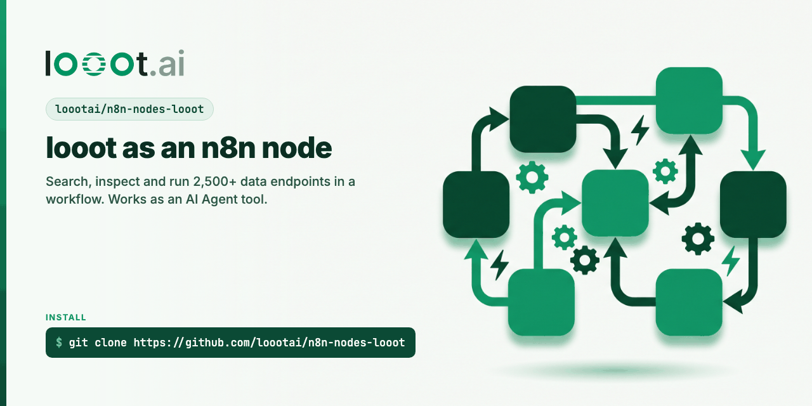

<p align="center"></p>

# n8n-nodes-looot

[](LICENSE) [](https://docs.looot.ai)

n8n community node for [looot](https://looot.ai): one account and one prepaid balance for 2,500+ data
endpoints (find and verify emails, enrich companies, Google results, news, and more).

## Install

In n8n, open Settings, then Community Nodes, then Install, and enter `n8n-nodes-looot`. The package is on [npm](https://www.npmjs.com/package/n8n-nodes-looot).

See also: [awesome-looot-use-cases](https://github.com/loootai/awesome-looot-use-cases) (copy-paste recipes) and [awesome-gtm](https://github.com/loootai/awesome-gtm) (open-source GTM tools).

## Operations

Pick a Resource, then an Operation. Every operation of the [looot API](https://docs.looot.ai/reference) is here.

**Billing**

| Operation | Route |
|---|---|
| Get Balance | `GET /v1/balance` |
| List Ledger Entries | `GET /v1/ledger` |
| List Top-Ups | `GET /v1/top-ups` |
| Request a Top-Up | `POST /v1/top-ups` |

**Public Catalog** (browse without an account)

| Operation | Route |
|---|---|
| Catalog Overview | `GET /v1/catalog/overview` |
| Compare Catalog Items | `POST /v1/public-catalog/compare` |
| Get a Catalog Item | `GET /v1/public-catalog/{catalogItemId}` |
| Search the Public Catalog | `GET /v1/public-catalog` |

**Catalog**

| Operation | Route |
|---|---|
| Discover Operations | `GET /v1/discover` |
| Inspect an Operation | `GET /v1/operations/{endpointId}` (also works with `job:<id>`) |
| List Catalog Endpoints | `GET /v1/catalog/endpoints` |
| Search the Catalog | `GET /v1/catalog/search` |

**Request**

| Operation | Route |
|---|---|
| List Capability Requests | `GET /v1/capability-requests` |
| Request a Capability | `POST /v1/capability-requests` |

**Run**

| Operation | Route |
|---|---|
| Cancel a Run | `POST /v1/runs/{runId}/cancel` |
| Create a Run | `POST /v1/runs` with `endpointId`, `input`, `idempotencyKey`, `fallback`, `wait` |
| Get a Run | `GET /v1/runs/{runId}` |
| List Run Attempts | `GET /v1/runs/{runId}/attempts` |
| List Runs | `GET /v1/runs` |

Create a Run spends credit and Request a Top-Up creates a checkout. The rest are free reads.

Create a Run sends `endpointId` as an endpoint ID or `job:<job id>`, for example `job:people.email.find`.
With Fallback on, looot tries the next provider of the same job when the first finds nothing. If you leave
Idempotency Key empty the node uses `n8n-<execution id>-<item index>`. Search the Catalog hides endpoints that are
not runnable for your account unless you turn off Runnable Now Only.

Version 0.2.0 adds the Resource field. Workflows built on 0.1.x need their looot nodes set again.

The node sets `usableAsTool: true`, so an AI Agent can call it as a tool (set
`N8N_COMMUNITY_PACKAGES_ALLOW_TOOL_USAGE=true` on self-hosted n8n).

## Use looot over MCP in n8n

looot also has an MCP server at `https://api.looot.ai/mcp` (streamable HTTP, 19 tools). n8n verified community
nodes cannot ship the dependencies an MCP client needs, so this is a workflow template that uses n8n's built-in
MCP Client Tool.

1. Import `workflows/looot-mcp-agent.json` (Workflows, Import from file).
2. Create an API key at [looot.ai/settings?tab=agent-tokens](https://looot.ai/settings?tab=agent-tokens). The page label is "API keys".
3. In n8n create a Bearer Auth credential and paste the key as the token.
4. Open the `looot MCP` node and pick that credential.
5. Open the chat model node and pick your own model and credential.
6. Open the chat and ask a question, for example "find the work email of the CEO of example.com".

`workflows/looot-node-agent.json` is the same agent built from this community node, with five looot operations as
tools (search, inspect, create a run, get a run, balance). Pick your looot API credential on each tool.

Which one to use. The node fits fixed workflow steps, where you know the operation and the inputs.
The MCP tool fits an agent that should find endpoints on its own, because it sees all 19 looot tools.

Not tested yet: the MCP Client Tool has only been run against looot with an operator token, not end to end with a
customer API key. Treat the Bearer step with a customer key as unverified until that is done.

## Credential

`looot API`: an agent token from the dashboard (Settings, Agent tokens) with `catalog.read`, `runs.read`,
`runs.execute`, `usage.read`, and the base URL (default `https://api.looot.ai`). The credential test calls
`GET /v1/balance`.

## Develop

```bash
npm install
npm run lint
npm run build
npm run dev      # n8n with the node loaded, hot reload
```

Dependencies are pinned to exact versions and the project sets `ignore-scripts=true`.

## Publish

`.github/workflows/publish.yml` publishes from GitHub Actions with provenance, which n8n requires for
verified community nodes. Auth is npm trusted publishing, so the repo stores no token. To release, bump
`version` in `package.json`, commit, and push a tag with the same number, for example `0.1.1`.
